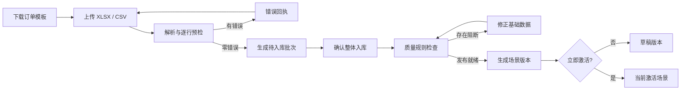

# 第十阶段开发任务：数据导入、质量治理与场景发布

## 1. 阶段目标

第九阶段已经形成订单、车辆和网点三类正式业务台账。第十阶段不继续扩展单条 CRUD，而是建设从外部业务数据进入平台、通过质量门禁、再发布为可求解场景的完整闭环：

- 提供标准订单 Excel 模板，并支持 `.xlsx` 与 UTF-8 CSV；
- 上传文件只生成预检批次，不直接修改正式订单；
- 逐行返回字段、行号和错误说明，支持下载 UTF-8 BOM 错误回执；
- 零阻断错误的批次才能整体入库，避免部分成功导致数据难以核对；
- 将质量规则作为正式配置持久化，管理员可启停规则和调整严重级别；
- 从当前基础数据生成新的调度场景版本，可选择发布后立即激活；
- 导入预检、确认入库、规则修改和场景发布全部进入审计日志。

## 2. 核心流程



## 3. 数据模型

### 3.1 `data_import_batches`

记录导入文件及其验证结果：

- `batch_code`：可展示、可检索的唯一批次号；
- `status`：`validated`、`rejected`、`committed`；
- `total_rows`、`valid_rows`、`error_rows`、`warning_rows`；
- `payload`：已经标准化并通过预检的订单数据；
- `errors`：最多保留 200 条结构化错误；
- `created_by`、`committed_by`、`created_at`、`committed_at`。

批次按 `(status, created_at)` 查询；两个用户外键均单独建立索引。文件解析和完整验证发生在事务外，确认入库时再次检查订单编号和网点状态，并以一次批量事务写入。

### 3.2 `data_quality_rules`

首批规则：

| 规则代码 | 默认级别 | 用途 |
|---|---|---|
| `order_active_node` | 阻断 | 订单必须引用启用网点 |
| `order_time_window` | 阻断 | 服务时间窗必须有效 |
| `vehicle_capacity` | 警告 | 待调度重量不超过三轮可用运力 |
| `cold_chain_vehicle` | 阻断 | 冷链订单必须有可用冷链车辆 |
| `single_depot` | 阻断 | 必须且只能有一个启用共配中心 |

规则支持 `enabled` 和 `severity` 配置；结构性数据库约束（主键、外键、正数重量、合法状态）不允许通过关闭规则绕过。

## 4. 权限与审计

- `admin`、`dispatcher`：下载模板、上传预检、查看批次、下载回执、确认入库、查看质量报告；
- `admin`：修改质量规则、生成或激活场景版本；
- 其他角色不进入基础数据维护路由；
- 审计动作：`preview_order_import`、`commit_order_import`、`update_quality_rule`、`publish_scenario`。

## 5. API

### 5.1 订单导入

- `GET /api/v1/master-data/orders/import/template`
- `POST /api/v1/master-data/orders/import/preview`
- `GET /api/v1/master-data/imports`
- `GET /api/v1/master-data/imports/{batch_id}/errors`
- `POST /api/v1/master-data/imports/{batch_id}/commit`

预检业务错误返回结构化批次；文件类型、编码或表头错误返回 `422`。批次不存在返回 `404`；重复确认、并发编号冲突或数据在预检后失效返回 `409`。

### 5.2 质量与发布

- `GET /api/v1/master-data/quality-report`
- `PUT /api/v1/master-data/quality-rules/{rule_id}`
- `POST /api/v1/master-data/publish`

发布请求：

```json
{
  "name": "祁东县 2026 黄花菜采收期调度场景",
  "activate": false
}
```

存在启用的阻断规则未通过时返回 `409`；成功后复用 `scenario_versions` 生成 `master-data-vN`。立即激活时，原激活版本自动归档。

## 6. 前端设计

视觉基准：[第十阶段数据质量与批量导入概念稿](concepts/phase10-data-quality-import.png)

新增 `/master-data/quality` 页签：

- 顶部汇总待调度订单、可用车辆、启用网点和阻断问题；
- 左侧发布就绪检查采用表格/列表，不使用卡片网格；
- 右侧场景发布面板包含名称、立即激活开关和生成按钮；
- 下方展示最近导入批次及错误回执操作；
- 约 540px 右侧抽屉完成“上传文件—数据预检—确认入库”三步；
- 订单台账增加“批量导入”入口并跳转到质量页自动打开抽屉；
- 桌面按 1600×1000 验证，移动端按 390×844 验证。

## 7. 验收路径

1. 下载订单模板并确认表头、示例行和冻结表头；
2. 上传缺少网点或重复订单编号的文件，看到逐行错误；
3. 下载错误回执，确认 UTF-8 BOM 与中文内容；
4. 上传合法文件，预检通过后确认入库；
5. 在订单台账检索到新订单；
6. 查看规则检查结果，修改规则严重级别并确认审计记录；
7. 输入场景名称并生成草稿；
8. 选择立即激活后再次发布，确认原场景归档、新场景激活；
9. 验证无权角色不能调用规则修改与场景发布接口。

## 8. 完成定义

- Alembic 升级到 `20260726_0010`；
- 导入模板、预检、错误回执、确认入库、质量规则和场景发布 API 测试通过；
- 批量入库为短事务且不会部分成功；
- Vue TypeScript 生产构建通过；
- Docker 数据库、Redis、API、任务队列与前端保持健康；
- 桌面和移动核心路径浏览器回归通过，控制台无相关错误；
- 概念稿与最终页面完成同尺寸视觉对照；
- 临时验收订单、场景、批次与截图之外的测试数据被清理。
