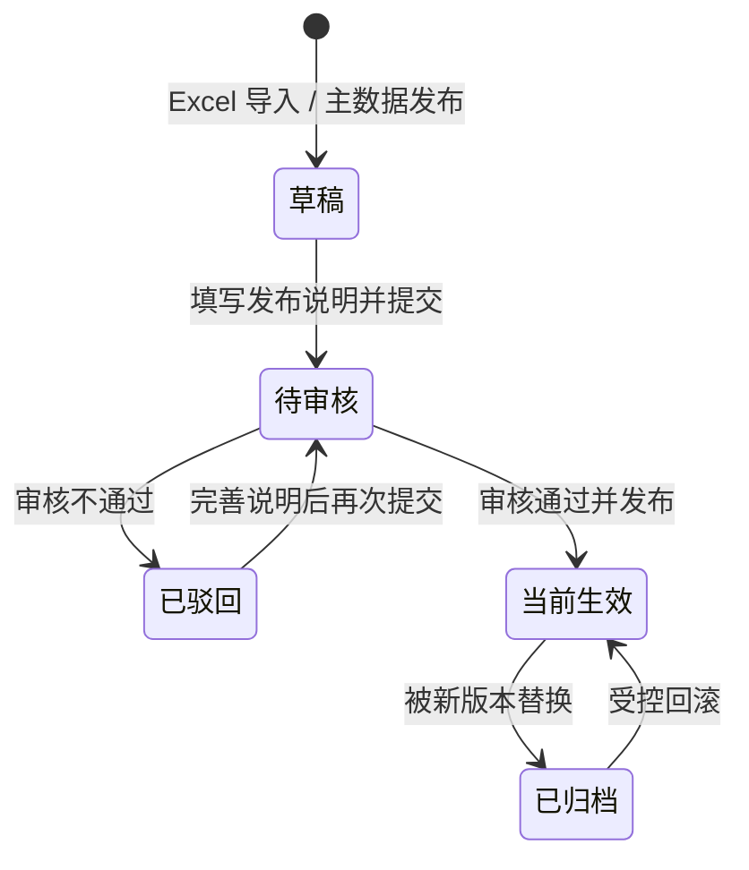

# 第十一阶段开发文档：场景版本治理与发布审核

## 1. 阶段目标

第十一阶段把前期的“导入后直接启用”升级为比赛演示所需的可审计生产流程：县域节点、订单、车辆数据形成独立版本，经校验和人工审核后才能进入智能调度；出现异常时可以回滚到任一历史稳定版本。

本阶段不扩展多级会签、电子签章等重型 OA 能力，重点证明平台具备业务数据治理、算法输入可复现和生产变更可控能力。

## 2. 业务流程

约束：

- 同一时刻只允许一个 `active` 版本。
- 审核通过和回滚使用数据库事务，并按固定顺序锁定目标版本与当前生效版本。
- 每次状态变化写入独立轨迹表，不覆盖历史记录。
- 原 `/activate` 接口暂时保留兼容，供前期测试与旧调用方过渡；新界面不再暴露直接启用入口。

## 3. 数据模型

### `scenario_versions` 新增字段

| 字段 | 用途 |
| --- | --- |
| `fingerprint` | 规范化 JSON 的 SHA-256，用于证明算法输入版本 |
| `release_note` | 提交审核时的版本发布说明 |
| `submitted_by/submitted_at` | 提交人和提交时间 |
| `reviewed_by/reviewed_at` | 审核人和审核时间 |
| `review_note` | 审核或回滚结论 |

状态扩展为 `draft / pending_review / rejected / active / archived`。

### `scenario_version_transitions`

保存版本编号、变更前状态、变更后状态、操作说明、操作者和时间。场景版本删除时轨迹级联删除；用户删除时操作者置空，以保留审计事实。

数据库迁移：`20260728_0011_scenario_governance.py`。

## 4. 接口

| 方法 | 地址 | 说明 |
| --- | --- | --- |
| GET | `/api/v1/scenarios` | 搜索、状态筛选、状态汇总 |
| GET | `/api/v1/scenarios/{id}` | 版本详情和完整状态轨迹 |
| GET | `/api/v1/scenarios/compare` | 节点、订单、车辆及核心指标差异 |
| POST | `/api/v1/scenarios/{id}/submit` | 草稿或驳回版本提交审核 |
| POST | `/api/v1/scenarios/{id}/approve` | 审核通过并原子发布 |
| POST | `/api/v1/scenarios/{id}/reject` | 驳回并记录审核意见 |
| POST | `/api/v1/scenarios/{id}/rollback` | 历史版本原子回滚 |

所有写操作要求管理员权限，并写入平台审计日志；说明字段长度为 2–500 个字符。

## 5. 版本差异规则

- 对象以业务 `id` 匹配，分为新增、删除、修改。
- 修改项列出发生变化的字段，单条最多展示 6 个字段，避免界面噪声。
- 汇总对比节点数、订单数、车辆数、总货量、可用冷链运力。
- 每组明细响应最多返回 100 条，保证大数据量下界面仍可用。

## 6. 前端工作台

界面由以下区域组成：

1. 状态概览：当前生效、待审核、草稿/驳回、历史总量。
2. 版本列表：关键词搜索、状态筛选、选中态和业务数据摘要。
3. 版本详情：数据指纹、提交/审核信息、状态操作和时间线。
4. 导入抽屉：模板下载、文件校验、明确说明“导入不直接生效”。
5. 差异抽屉：基准/目标交换、指标增量、节点/订单/车辆逐项变化。

视觉概念：

- [场景治理主界面](concepts/phase11-scenario-governance.png)
- [版本差异抽屉](concepts/phase11-scenario-diff.png)

## 7. 验收标准

- 数据库升级到 `20260728_0011`，既有场景自动补齐指纹和初始轨迹。
- 草稿提交、驳回、再次提交、审核发布、历史回滚全流程可执行。
- 发布和回滚后数据库始终只有一个生效版本。
- 差异接口能识别订单重量等字段变化并计算指标增量。
- 原有后端回归测试全部通过，并新增完整治理流程测试。
- 前端生产构建通过；桌面端和手机端均无横向溢出、遮挡或控制台错误。
- Docker 环境迁移、健康检查、页面交互均通过。
