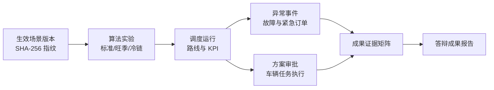

# 第十二阶段开发文档：竞赛答辩与成果证据中心

## 1. 阶段依据

竞赛方案明确：最终成绩由初赛作品 30%、决赛作品 30%、现场答辩 40% 构成，决赛包含现场陈述、系统展示与答辩。前十一阶段已经完成智能调度、路径规划、动态重调度、执行闭环、算法实验、主数据治理和场景版本审核，但证据分散在不同功能页，不利于评委在有限时间内快速核验。

第十二阶段建设“竞赛答辩中心”，把真实数据库中的场景版本、实验结果、调度方案、异常事件、执行任务和系统保障状态组织成一条可追溯证据链，并生成自包含成果报告。

## 2. 阶段目标

- 用 6 分 30 秒标准脚本串联业务背景、AI 调度、异常重调度、审批执行和成果证据。
- 自动计算数据场景、算法实验、执行闭环、系统保障四类就绪度。
- 聚合最新有效 KPI，不在前端硬编码比赛成果。
- 建立“比赛要求—已实现能力—验证依据—状态”的证据矩阵。
- 支持一键进入对应业务页面和一键导出可打印成果报告。
- 不新增演示专用假数据，不修改算法结果，不绕过现有权限和审批流程。

## 3. 证据链

证据来源全部为现有业务表：

| 证据 | 数据来源 |
| --- | --- |
| 场景与输入 | `scenario_versions`、`scenario_version_transitions` |
| 算法效果 | `algorithm_experiments` |
| 调度路线 | `optimization_runs` |
| 动态响应 | `events` 与带事件标识的运行记录 |
| 审批执行 | `dispatch_plans`、`driver_assignments` |
| 数据质量 | `data_import_batches`、`data_quality_rules` |
| 系统治理 | AI 配置、审计日志、数据库迁移与健康检查 |

## 4. 就绪度计算

每个维度满分 100，整体分数为四个维度的算术平均值。

### 4.1 数据场景

- 存在且仅存在一个生效场景：40 分。
- 场景包含 SHA-256 数据指纹：20 分。
- 节点、订单、车辆均有有效数据：20 分。
- 场景校验通过：20 分。

### 4.2 算法实验

- 存在已完成实验：40 分。
- 完成标准、旺季、冷链三类案例：30 分。
- 实验场景指纹与当前生效场景一致：20 分。
- 实验服务率达到 95%：10 分。

### 4.3 执行闭环

- 存在审批方案：30 分。
- 方案已批准或下发：25 分。
- 已生成司机任务：25 分。
- 至少有任务进入接单、执行或完成状态：20 分。

### 4.4 系统保障

- 数据库可读写并完成当前迁移：30 分。
- 存在启用的 AI 配置：20 分。
- 路网服务或离线回退可用：20 分。
- 场景版本有完整状态轨迹：15 分。
- 最近存在审计记录：15 分。

未满足项在页面中标记为“需补充”，不会伪装为已验证。

## 5. 接口设计

| 方法 | 地址 | 权限 | 说明 |
| --- | --- | --- | --- |
| GET | `/api/v1/competition/readiness` | 管理员、调度员 | 聚合就绪度、核心 KPI、演示脚本与证据矩阵 |
| GET | `/api/v1/competition/report` | 管理员、调度员 | 生成自包含、可打印的 HTML 成果报告 |

接口保持只读，不创建调度结果，不自动批准方案，不改变生产场景。

## 6. 页面设计

视觉规格：[第十二阶段竞赛答辩中心概念稿](concepts/phase12-competition-center.png)。

### 6.1 信息架构

1. 顶部就绪度轨道：整体分数和四类分项。
2. 左侧现场演示脚本：五个步骤、时长、目标页面和当前选中态。
3. 中部核心成果：里程改善、成本节约、服务率、求解耗时和基线对比。
4. 中部证据矩阵：对应第二赛道的智能调度、路径规划、动态响应、可视化和成果转化。
5. 右侧答辩状态：生效场景、实验指纹、服务状态和答辩提示。

### 6.2 设计系统

- 背景：冷灰 `#f3f6f4`；表面：纯白。
- 主色：深绿 `#073d2a`、操作绿 `#147a4a`；强调色：`#f2b233`。
- 容器：10–14px 圆角、1px 冷灰边框、轻阴影。
- 图标：继续使用 Lucide 线性图标，16–20px。
- 字体：沿用 Microsoft YaHei / PingFang SC；控制文本显式定义字号。
- 桌面端保持三栏；手机端按“就绪度—脚本—成果—证据—提示”顺序纵向排列。

## 7. 成果报告

成果报告为独立 HTML，包含：

- 项目定位和第二赛道对应关系。
- 当前生效场景与 SHA-256 指纹。
- 算法模型、约束和三压力案例。
- 核心 KPI 与人工基线对比。
- 动态异常响应和审批执行证据。
- 证据矩阵与就绪度缺口。
- 生成时间和关键记录编号。

报告不包含 API Key、密码、数据库连接信息、客户电话等敏感字段。

## 8. 验收标准

- 聚合接口在部分证据缺失时仍能返回结构化结果和明确缺口。
- 所有 KPI 来自数据库记录，记录编号可跳转到现有模块核验。
- 报告可下载、浏览器打开和直接打印。
- 管理员和调度员可访问；司机、查看者和未登录用户不可访问。
- 前端生产构建通过，桌面端和手机端无溢出或遮挡。
- 自动化测试覆盖权限、就绪度计算、证据来源和报告脱敏。
- Docker 环境接口、报告和页面全部通过验收。
